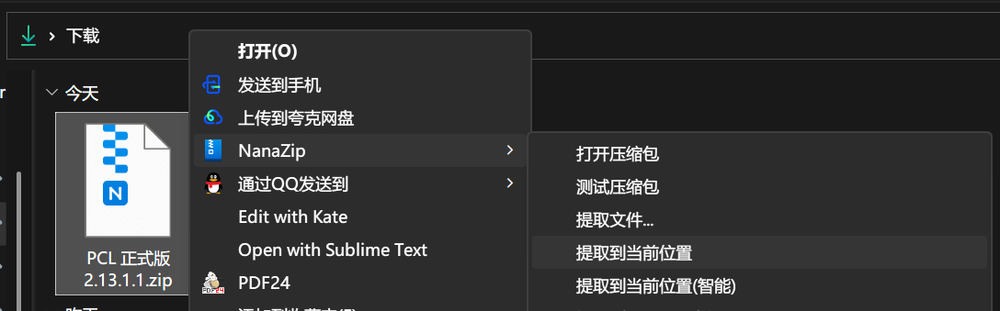
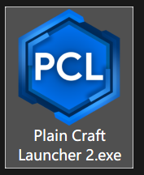
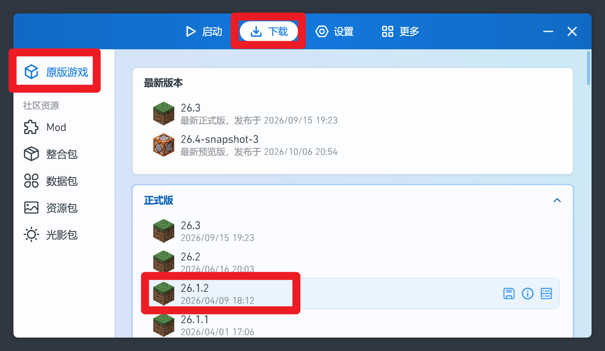
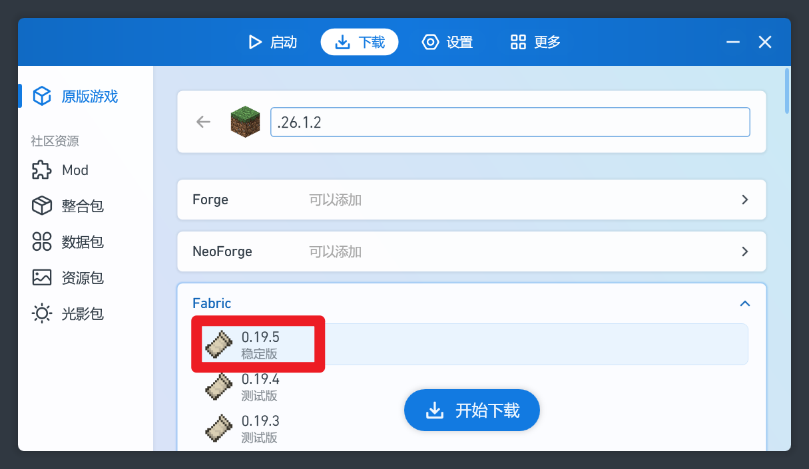
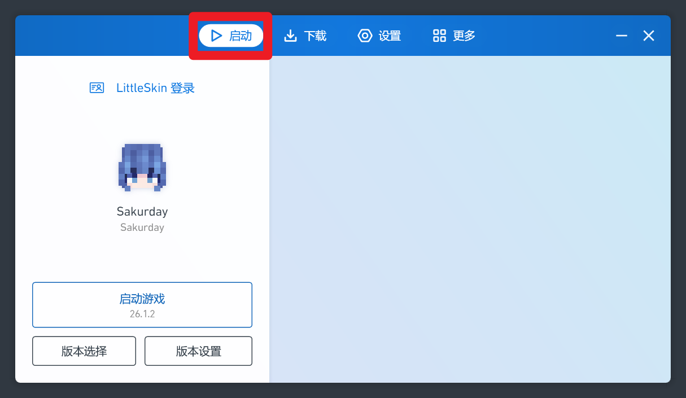

# 如何下载 Minecraft Java 版

如果你想加入社区服务器, 那么你将绕不开这个世纪难题.

# 1. 下载 PCL 启动器

PCL 的唯一官方下载地址:

[https://afdian.com/p/0164034c016c11ebafcb52540025c377](https://afdian.com/p/0164034c016c11ebafcb52540025c377)

有三个下载地址, 你选哪个都行. 推荐选"备用下载", 输入提取码, 然后下载最新版即可

# 2. 解压到正确位置

找到你下载的 `PCL 正式版 x.xx.x.x.zip` 压缩包, 右键这个压缩包, 找到你电脑上压缩软件的选项, 选择"解压到此处"

然后你会在这个文件夹找到 `Plain Craft Launcher 2.exe`.

如果你解压出来是一个文件夹, 点进去, 也能看到 `Plain Craft Launcher 2.exe`.

# 3. 将 PCL 放到合适的位置

打开"此电脑", 你会看见电脑有 C 盘, 还可能有 D 盘或者 E 盘等

你需要找一个剩余容量比较大的盘, 在根目录新建一个文件夹 `pcl`

> 你可以按照你的喜好来起文件夹的名字, 但是不要用中文, 最好也不要带空格.

现在, 把 `Plain Craft Launcher 2.exe` 放进 `pcl` 文件夹, 这一步大功告成

从此以后, 你的 mc 里所有数据, 都会存进 `pcl` 文件夹, 包括游戏本体, 存档, 材质, 模组等等..

# 4. 自己下载游戏

打开 `Plain Craft Launcher 2.exe` , 同意用户协议后, 你可以看见上方有四个按钮, 分别是

- 启动: 在这个页面, 你可以启动游戏, 也可以管理不同游戏版本

- 下载: 在这个页面, 你可以下载新游戏版本, 和模组/材质包/光影包/整合包/数据包

- 设置: 主要用于调启动器设置. 一般来说你很少用到这个页面

- 更多: 一些无关紧要的东西, 你用不到

我们以 HFUT 的原版服为例, 教你怎么进原版服

1. 点击"下载"页面, 点击"原版游戏", 展开"正式版", 找到 "26.1.2"

2. 然后, 我们选上 "Fabric" 的最新版, 也就是最靠上的版本. 这样方便以后我们加模组

3. 点击"开始下载"就好了!

4. 下载完成后, 你可以在主页找到你下载的版本

5. 在进入 HFUT 的原版服之前, 你还需要使用 LittleSkin 登录. 我们的原版服不使用正版登录, 而是使用 LittleSkin 登录. 这是免费的.

[如何使用 LittleSkin 登录](./littleskin)

6. 启动游戏! 在群公告查看 ip 地址, 在多人游戏添加服务器即可!

# 5. 安装整合包文件

这个部分待完善...

